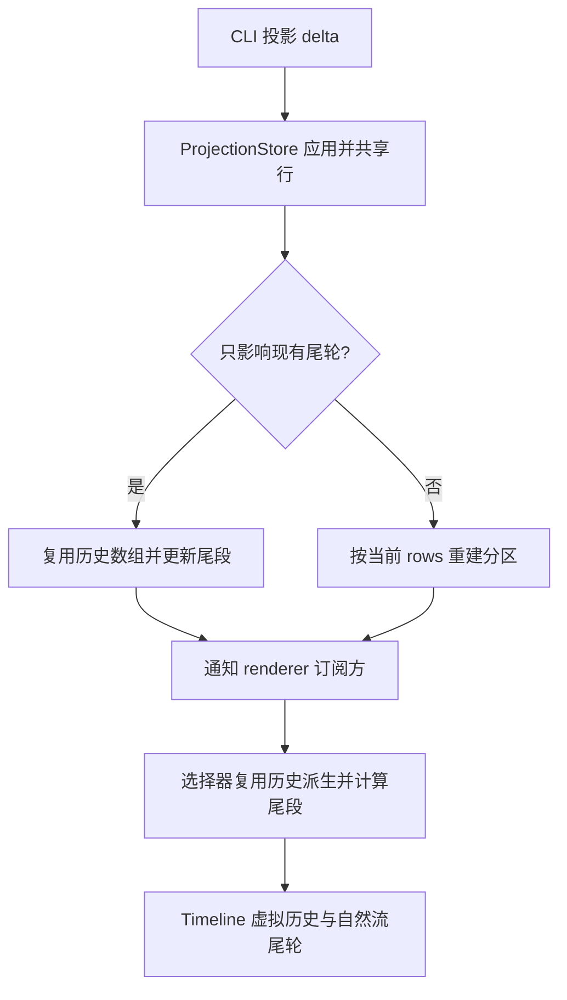

# Chat Virtual Scroll

> **V4 当前事实**：滚动视口、虚拟化、底部跟随与 renderer-local 滚动记忆由
> `packages/ui/src/v4/ConversationTimeline.tsx` 持有；消息事实仍来自
> `packages/shared/src/zcode-protocol-v4/` 与 `apps/zcode-cli/packages/bootstrap/src/zcode-protocol-v4/`。

## 目标

长对话只渲染当前视口附近的消息轮次，降低 renderer 在长会话中的 DOM 数量和 React 更新成本。

## 渲染策略

- `ConversationTimeline` 以 `ConversationTurnRenderUnit` 为虚拟滚动单位，而不是单条 projection row。
- 每个虚拟 row 对应一轮 user + assistant/tool 输出，避免 retry、fork、文件变更摘要和当前轮 loading 被拆散。
- 使用项目已有的 `@tanstack/react-virtual`，动态高度通过 `measureElement` 回写。
- 对话搜索先按 projection rows 建索引，再通过 virtualizer 定位并在已挂载 DOM 中高亮。

## resize 中的底部跟随

`ConversationTimeline` 是唯一滚动 owner，沿用 `followingRef` 和已有用户意图裁决。用户上滚立即解除跟随；滚回底部或点击回底恢复跟随；搜索、轮次定位、会话滚动记忆及历史前插继续保持原契约，不提供强制吸底开关。

- 跟随状态下，视口或内容列宽度变化引起的重排采用绘制前批处理：读取行高 → 更新 virtualizer 缓存 → 同步提交 React 占位高度和位置 → 再确认跟随权 → 吸底。不等待宽度稳定计时器，不将旧占位高度下的中间落点留到下一帧。
- 库的 observer 可能已更新缓存但仍排队等待 React 提交，因此批处理必须明确触发布局提交；不能依赖无差量的重复测量触发 render。同步提交仅在 ResizeObserver 回调内执行，批处理期间其他内容 effect 不抢先吸底。
- 离底时保持原宽度变化保护：resize 期间暂停逐行滚动补偿，不强制吸底；稳定后恢复正常测高补偿。本文不新增按句子保持屏幕坐标的阅读锚定。
- 每次批处理前后检查最新用户意图，resize 中上滚、搜索或会话切换不能被后续测高抢回滚动权。观察器监听视口和内容列，在同步提交前暂时取消内容列及父消息层蒙层的尺寸观察，下一帧恢复订阅，避免自身高度写入触发循环通知，同时持续覆盖 CSS 宽度过渡；测高与吸底本身不延后，不重复订阅虚拟行。消息内容变高继续走原有测高与内容提交逻辑。批处理只测已挂载行，不轮询或全量渲染历史。
- 桌面和手机 Web 共用此逻辑；空草稿保留顶部安全布局，不修改消息协议及 continuous/replayable 边界。

```text
尺寸变化 → ConversationTimeline 检查跟随权
  跟随 → 批量测高 → 同步提交布局 → 再检查跟随权 → 吸底
  离底 → 原有宽度变化与阅读位置保护
用户上滚 / 搜索定位 → 解除跟随（优先于布局回调）
回到底部 → 恢复跟随
```

验收：连续缩窄/放大时跟随落点与列表占位高度正确；resize 中上滚后保持离底；点击回底可重新跟随。原会话记忆、搜索定位和历史前插回归通过。运行时记录绘制前实际行底部与占位高度误差、离底距离，并检查可见画面，允许 1px 亚像素取整误差；不得以停止拖动后的落点代替过程验证。

浏览器回归：`node --test packages/ui/test/browser/manual-review/pending/conversation-timeline-resize.test.mjs`。覆盖真实 timeline、消息组件和虚拟列表的桌面/手机紧凑布局、深浅主题、内容列独立宽度过渡；数据为确定性 fixture，手机远控传输不属于该测试覆盖范围。桌面实际会话继续由 `conversation-session-v4-scroll.test.ts` 覆盖流式输出与滚动记忆。

## 滚动边界

- 旧的 `useChatAutoFollow` 多 flag 自动吸底状态机已删除；当前只保留一个小的 bottom-lock 状态和普通手动滚动容器。
- `ConversationTimeline` 使用一个小的 bottom-lock 状态：没有滚动记忆的新会话默认启用，消息追加、markdown/tool 详情撑高和 ResizeObserver 变化会继续写入最新底部 `scrollTop`。
- 右下角“滚动到底部”按钮只由当前滚动条位置控制：滚动容器不在底部时显示，到达底部时隐藏；用户手动滚回底部附近或点击按钮滚到底部都会重新启用 bottom-lock，避免生成中内容继续变高时错过锁底。按钮所在底部浮层使用 `background` token 的向上渐变遮罩，避免压住末尾消息时产生生硬边界。
- 当消息内容短到没有纵向滚动条时，视口没有可保留的历史阅读位置，ChatView 会把它视为 bottom-lock 可开启状态；这样后续流式内容撑出滚动条时仍能继续吸底。
- 正常对话态下，composer 通过 `bottomDock` 渲染在 timeline 的同一个滚动视口内，并使用 `sticky bottom-0` 吸附；“回到底部”按钮锚定在 dock 上方。
- 会话切换优先读取 renderer-local 的滚动记忆。记忆键由 `workspaceIdentity?.trim() || workspacePath`、`paneId` 与 session/task scope 组成；同一 renderer 的不同 pane 不共享阅读位置，不同桌面窗口或手机 Web renderer 也不共享内存。
- 若记忆保存时处于 bottom-lock，切回时滚动到**当前**最新底部并继续启用 bottom-lock；否则恢复保存的像素 `scrollTop`，按当前内容高度夹紧到合法范围并保持离底。如果没有记忆，则打开时定位底部并启用 bottom-lock。
- 恢复先在 layout 阶段写入一次，下一 animation frame 在 virtualizer 首轮测高后再校正一次；若用户已经滚动，第二次校正必须让出写入权。
- 搜索结果、高亮查找、fork 来源和 turn navigator 跳转都属于定位型滚动，定位后保持离底；该位置可被后续 task 切换记忆。
- 补全旧历史后继续按新增高度恢复滚动位置，避免视口跳到历史顶部。
- 对话内容宽度连续变化时，动态行会因文字换行分批重新测高。离底阅读状态必须保持当前 `scrollTop`，禁止 virtualizer 按每条视口上方行逐次补偿而造成上下抖动；吸底状态采用上面的同步测高批处理，每次视口 resize 都按已提交的新高度吸底。宽度稳定后恢复普通动态测高补偿，新消息与流式内容的正常 bottom-lock 不受影响。
- bottom-lock 不写入 localStorage、relay、main process、host process 或 task runtime；滚动记忆只在当前 renderer 生命周期存在，并由 200 项 LRU 回收。

## 历史详情懒渲染

- `AssistantMessage` 的历史区只在展开时调用 `renderHistoryParts`，默认闭合时只保留摘要行。
- `ToolLayout` 支持 `renderContent`，工具详情只在展开或强制展开时构造，避免闭合工具提前挂载大量 markdown、diff 和子工具 DOM。
- 历史区和工具区的展开状态按 message/tool key 保存在 renderer 内存中，虚拟滚动导致组件卸载再挂载时不会丢失用户刚展开的细节。
- 流式输出、被中断和 settling 状态仍会强制展开历史区，保证正在发生的内容不会被隐藏；流式结束后自动回到摘要态。

## 渲染缓存与 memo 边界

### 每帧派生成本（2026-10-30 上游同步）

- `ConversationProjectionStore` 仍是消息投影的唯一 owner。按不可变 rows 数组身份派生「历史 + 尾段」，不新增消息状态或写入路径；两段拼接逐项等于 rows，轮次不相交。交错追加旧轮时尾段可含多轮。
- 应用仅影响尾轮的 delta 时，在通知订阅方之前登记新分区，沿用历史数组；更新旧行、前插、rewind、新轮或 snapshot 更换时重新分区。对象池从尾部查找受影响行，找到全部目标后停止。
- render unit 选择器按历史数组引用复用历史派生；只有缺 header 的轮次读取 session phase、running 轮次读取时钟、插件卡片读取固定裁决时，相关输入才使历史缓存失效。尾轮被过滤、转终态、新轮开始和插件手动固定后，结果必须与全窗构建相等。
- running 尾轮独立为自然流 DOM，虚拟历史沿用同一数组及 unit 引用。插件 UI 派生只在回合序列或插件工具行变化时重算。搜索关闭时返回稳定空索引；搜索缓存跟随不可变 unit 身份失效，历史正文修订不能沿用同 key 的旧命中。
- 所有缓存只属于 renderer，不改变 CLI/Host 的消息事实、队列、生命周期、身份和传输协议。保留双栏独立滚动记忆和 resize 跟随规则。



验收：尾轮 token 更新不访问历史行并保留虚拟历史引用；历史修订、交错轮次、裁剪、新轮、终态、时钟和固定裁决结果与全窗构建一致。真实 timeline 的流式更新不得重渲染不变的历史轮次；桌面/紧凑布局与深浅主题回归通过。浏览器 fixture 只验证本地渲染和滚动，不代表真实 SSH 链路验收。

- 已完成 markdown 消息固定走 `Streamdown` static 模式；只有真实流式动画进入 streaming/block 路径，避免虚拟滚动和历史懒渲染反复重挂载完成态消息时触发 Streamdown 内部更新循环。
- `DiffViewer`、edit inline diff、`ToolLayout`、`ToolCallBlock`、`AssistantMessage`、`ChatMessage` 和 turn group 边界使用 `memo`，减少历史消息在父组件更新时的重复 commit。
- turn group 内传给单条消息的 retry、文件切换、feedback、fork 回调通过 `useCallback` 稳定，避免 memo 被 map 里的 inline function 抵消。
- diff 只稳定 options 和 viewer 输入，不缓存实际 DOM；主题、字号、换行和行号设置变化时仍会正常重渲染。

## 远控边界

本改动只影响 UI 层渲染，不改变 ZCode task 消息流、snapshot、queue 或恢复语义：

- 桌面端 `desktop-continuous` 仍保持 direct continuous 主链路。
- 手机远控 `web-remote-replayable` 仍通过 replayable snapshot/gap 恢复边界展示消息。
- 远控全量历史仍由显式加载控制，不因虚拟滚动重新触发隐式全量快照传输。
