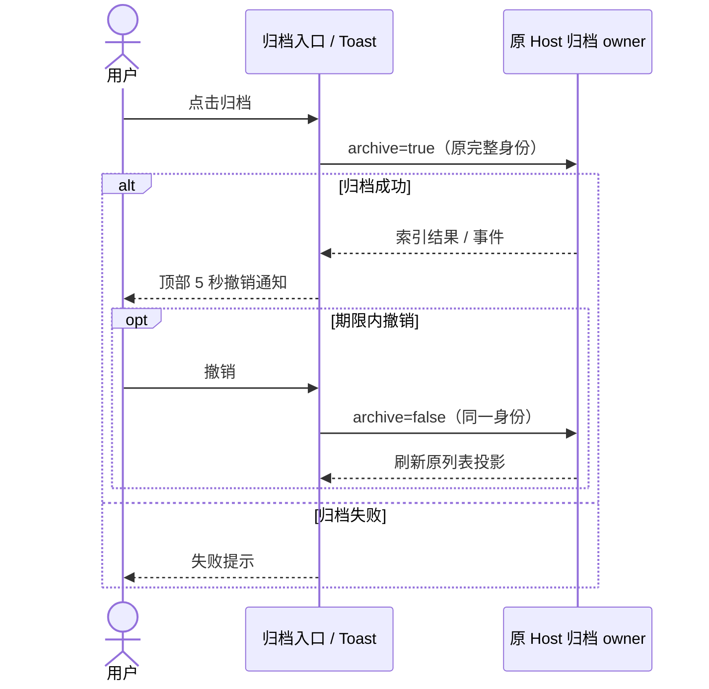

# Task List Context Menu

任务列表项新增右键菜单，统一承接 task 级快捷操作，避免把所有动作都堆到 hover 按钮或 Header more。

## 当前菜单项

- Pin task
- Rename task
- Archive task
- Mark as unread
- Open in Finder / File Explorer / File Manager
- Copy path
- Copy log path
- Go to config

## 交互说明

- `Pin task` 会持久化到 task 元数据，刷新或恢复后仍保持置顶；已置顶项菜单会显示 `Unpin task`
- 已置顶任务会常驻在列表顶部的独立 `Pinned` 分组里，不再和普通任务混排；折叠态下也始终可见
- `Rename task` 使用弹窗完成，支持 `Enter` 提交、取消关闭
- `Archive task` 会把任务标记为 archived，并从默认任务列表中隐藏
- 任务行 hover、右键菜单、分组和顶部更多菜单中的归档均单击立即提交，不显示二次确认。
- 归档成功后复用顶部居中 Toast，显示“会话已归档”和“撤销”，持续 5000ms 后自动消失；失败只显示失败提示。通知仅保存本次操作的目标与回调，不成为归档状态 owner。
- 撤销固定指向原 workspacePath + workspaceIdentity + taskId（远端沿用原 Controller/attachment），调用已有 `archive=false` / `unarchiveTask` 命令，成功后按原链路刷新列表；切换会话或原行卸载不改变撤销目标，不自动重开会话。撤销失败显示提示，不能伪造恢复。Host 仍是 archived 唯一写者，CLI 时间与分组归属不变。

验收：侧栏首次点击即归档；顶部菜单无确认框；撤销恢复原任务且同名远端不串写；通知约 5 秒自动消失，超时保持归档；归档或撤销失败不显示虚假成功。

- `Mark as unread` 会持久化到 task 元数据；重新启动 app 后仍保留蓝点，打开该任务时再自动清除
- 重命名会持久化到 `tasks-index.sqlite` 并同步更新运行中 task 的内存 meta；恢复和快照回写必须遵守 [Task Title Authority](./task-title-authority.md)，避免 raw session snapshot 把手动标题还原成自动标题
- pin / unread / archive 也会同步更新运行中 task 的内存 meta，避免后续 session 持久化把旧状态写回来
- `Copy path` 指向 task 的持久化快照文件路径
- `Copy log path` 指向 task 对应的原生日志路径；ZCode Agent 使用按日期滚动的结构化 JSONL 日志
- `Go to config` 会复用当前持久化的编辑器偏好；如果无法直接用编辑器打开，则回退到文件管理器

## 2026-10-27 验证

相关单测 8 文件 / 44 项通过，覆盖单击提交、无确认态和额外行渲染、在途重复点击、原行卸载后的精确远端撤销及归档/撤销失败。Electron `desktop-e2e-20261027085701687-p79017-96f4847d470ad0d8` 1/1 通过：侧栏单击归档、顶部居中“撤销”恢复、顶部菜单不弹确认、通知约 5 秒后消失、刷新后保持归档；截图 `archive-undo-toast.png` 已检查。首次运行在旧全局发送 helper 将文字写入非目标草稿时失败，专项改用已有 pane 作用域 helper 后通过，未修改共享 helper。全仓 typecheck、E2E typecheck、架构检查通过；Lint 为 93 warnings / 0 errors。实际 SSH/WSL 和手机链路未运行，精确远端路由由单测覆盖。
