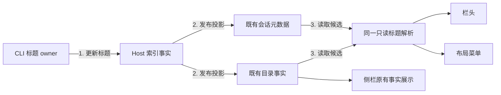

# Task Title Authority

Task title can come from several places during a session lifecycle. Renderer code must treat them as ordered candidates instead of letting the newest snapshot string always win.

## Title priority

1. User-renamed title with `titleOverridden=true`.
2. Agent-generated title from the session/title update pipeline.
3. First user query title used as the initial optimistic title.
4. The agent default placeholder `New session`.

## 技能引用的初始标题

- CLI 从首条输入派生标题时，先将 `[$skill](path)` 技能链接转换为 `$skill`，再合并空白并按现有长度上限截断。多个技能和后续需求文字保留；仅引用技能时使用技能名称。
- 只处理 Markdown 解析器识别到的技能链接，行内代码、普通链接和不完整链接保持原文。消息正文、发给模型的技能路径、模型生成标题和用户手动标题不受影响。
- 派生结果仍由 CLI 落盘为 `first_input`，并通过既有标题事件同步到 Host；顶部和侧栏读取同一事实，不分别修补显示。已落盘的历史标题不在此变更中迁移。
- 验收覆盖 macOS、Windows、带空格或括号的技能路径、多个技能、仅技能、清理后截断，以及内置与外部引擎的落盘标题、标题事件及原始正文一致性。

## Renderer restore rule

- CLI owns persisted titles and title source; `tasks-index.sqlite` contains their read-only Host projection.
- The active header reads the existing workspace-scoped `ZCodeTaskService.getTaskMeta` and refreshes on Host metadata events. It does not depend on a sidebar/query-cache row or call `readSession` to obtain a title. Historical and archived sessions can have metadata before their CLI runtime is active.
- `readSession` / `resumeSession` returns a raw agent snapshot. Its projected task meta is only a runtime candidate and can be missing app-side `titleOverridden`.
- Restore and remaining task cache sync paths must merge raw snapshot meta with indexed/query-cache meta before writing renderer caches. The active header uses Host metadata directly; existing optimistic metadata is used only before the indexed record arrives.
- A raw snapshot title must not overwrite a title whose existing meta has `titleOverridden=true`.
- `New session` must not overwrite a non-placeholder title, even when the snapshot has a newer `updatedAt`.
- Generated titles may replace the first query title when there is no user override.

## Compatibility

### 工作台栏头与视图菜单（UX09）

- 栏头和布局菜单共用 `useWorkbenchSessionTitle(tab)` 只读解析。目录仍由 `ProjectDirectoryProvider` 持有，CLI/Host 是已提交标题 owner；hook 不请求正文、不持久化标题、不新增缓存或写入路径。
- 使用 `workspaceIdentity?.trim() || workspacePath` 与 sessionId 精确匹配目录事实和既有会话元数据。remoteSessionId 仍由 Tab scope 携带，不能按相同 path 跨 attachment 借用标题。
- 候选复用 `mergeTaskMetaCandidates`：按既有 updatedAt 修订顺序选择，保留 titleOverridden 手动标题及非占位标题的保护。非空缓存没有无条件优先权；目录事实与缓存相同时，侧栏、栏头、菜单同名。生成与 first_input 的来源优先级由 CLI 已有事实链处理，UI 的 ZCodeTaskMeta 不含 titleSource，不推断来源或创造新版本。
- 草稿、空白标题和默认 `New session` 在栏头及菜单统一显示已有本地化“新会话”。不向用户显示 sessionId 前缀。栏头可视觉截断；菜单显示完整标题，并在 title 属性保留完整名称。
- 先由 CLI 更新标题，再由 Host 索引发布目录/元数据变更，最后两个入口从同一候选重算；无需重开会话。较新的占位快照不能把有效标题降级。

- 窄屏顶栏继续为可见浮层操作留白。共享 `resolveTopOverlayLeadingPaddingClass` 使用导航隐藏所用的 `useIsMobileCompactViewport`（`max-width: 767px`）作为唯一断点：侧栏隐藏且 compact 时，各平台/fullscreen/update 变体相对原宽屏预留减去两个 28px 导航按钮及两个 4px 间隙，共 64px；宽屏与侧栏可见规则不变。WorkspaceHeader 和 SidePane 完整视图的 tab 栏共用此规则，不改变右侧 actions 实测占位。导航尺寸或隐藏断点变更时须同步维护本合同及回归，标题必须有可读宽度且不与可见浮层按钮重叠。
- 验收：缺缓存、陈旧/空/占位缓存、手动标题、生成取代首输入、较新事实与恢复防降级、真正无标题/草稿、相同 path/ID 不同 identity；真实 Electron 通过侧栏改名后验证各入口即时同步，生成后同步及 renderer/cold 恢复不降级，检查两主题、两语言、窄窗及键盘。

- Workspace-scoped title lookup uses `workspaceIdentity?.trim() || workspacePath`, matching remote workspace isolation. The active read also belongs to its scoped service/attachment and task ID; late responses cannot overwrite a newer target or request.
- The rule applies to desktop `desktop-continuous` restore and web remote `web-remote-replayable` restore. Replayable recovery can use snapshots to refill runtime fields, but it must not bypass the same title authority merge.

## 2026-11-11 Skill 标题精简

首条输入标题和标题生成 sidecar 共用 Skill 引用清理：完整 Markdown Skill 链接只保留 `$skill`；同名重复引用只保留一次；能精确识别到 `SKILL.md` 的未闭合文件链接也可去掉路径，保留随后的中文需求。普通链接、代码片段及不能确定边界的残缺链接保持原文。先清理再做各自长度限制。原始消息、模型业务输入、Skill 加载与手动命名优先级不变。

## 2026-11-12 外部引擎自动标题回写

- Codex / Claude Code 的 `session_info_update` 和内置 sidecar 生成结果在 CLI 既有自动标题持久化入口统一清理 Skill 引用；不能仅清理首条输入或标题模型的请求素材。事件中的标题与实际落盘结果一致。
- sidecar 在截断生成结果前清理引用，避免较长路径把后面的任务含义挤掉。外部引擎原始 prompt 和历史消息保持原文。
- 恢复历史 `generated` 标题时，清理标题本身能够完整识别的 Skill 引用，通过 CLI 的标题事件同步 Host 镜像。`custom` 标题保持不变；已有 `first_input` 标题继续只修复能由原始首条输入证明的历史标题。
- 回归覆盖两种外部引擎的标题事件、重复引用、长路径、恢复旧自动标题，以及自动回写和恢复期间对手动标题的保护。
