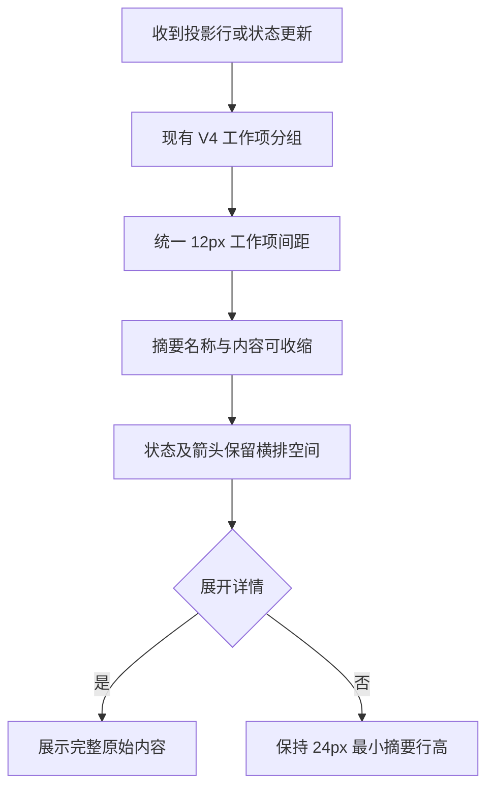

# 工具输出流布局

共享桌面和手机 Web 的工具摘要保持紧凑、连贯；复用现有 `ToolSummaryRow`、`QueuedSummaryContent` 与 V4 工作项容器。

- 连续工具工作项间距统一为 12px，摘要最小行高 24px；正文、用户消息及工作段边界保留各自间距。
- 工具名称、命令和路径在摘要里使用单行省略，受可用宽度约束；状态与展开箭头保留空间，状态文字不能被挤成竖排。
- 摘要省略不删除原文。展开工具仍展示完整参数、输出及错误详情；纯文本摘要提供原文 title。
- 追加工具、更新状态时，已存在摘要的高度与顺序保持稳定；不为短暂状态更新插入空块或重复内边距。
- 继续使用现有投影及滚动权规则，不增加消息队列或重写协议状态；运行中输出由投影按原顺序追加。

验收使用真实 React 组件的确定性浏览器 fixture：966px 桌面、375px 手机及横屏，深浅主题、中英文、减少动态效果和放大字号。检查长工具名与命令、横向溢出、均匀间距、流式追加后旧行位置不变，以及键盘展开后原文可读。该 fixture 验证渲染更新，不代替真实模型和远程流式链路验收。
