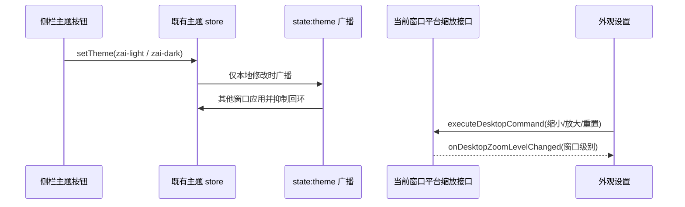

# 工作区侧栏底部

## 当前规则

- 工作区侧栏底部保留“设置”入口和单击太阳/月亮主题快捷按钮；不再显示快捷偏好菜单。应用更新就绪时仍显示更新入口。
- 当前解析主题为深色时显示太阳，按钮将主题切至 Zai Light；当前解析主题为浅色时显示月亮，按钮将主题切至 Zai Dark。System 偏好也依照当前系统解析主题切换，点击后成为明确的 Zai 偏好；图标、tooltip 与 aria-label 始终描述将切换到的主题。系统偏好变化只刷新展示，不写入偏好。
- 设置页只在侧栏顶部提供一次“返回工作区”。设置侧栏不挂载工作区 footer，也不为底部返回按钮预留空间。
- 设置页的语言与界面模式通过“常规”、主题（含 System）通过“外观”修改；桌面整体缩小、放大、重置通过“外观”中的当前窗口缩放控件操作，普通 Web 不显示该控件。顶部返回沿用既有导航行为。

## 实现与验收

- 工作区底部：`packages/ui/src/WorkspaceSidebarFooter.tsx`。
- 设置侧栏与顶部返回：`packages/ui/src/SettingsPage.tsx`。
- 验收：设置页仅有一个返回入口，点击回工作区；工作区底部可打开设置并在深浅/System 下切换主题，系统偏好变化后图标和可访问名称同步；跨窗口广播不回环。桌面设置缩放遵守既有 -3 至 5 级限值且响应窗口级别事件；Web 隐藏缩放控件。中英文、键盘 Tab/Enter/Space、深浅与窄窗设置导航均可操作。
