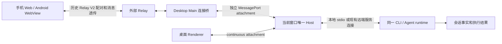
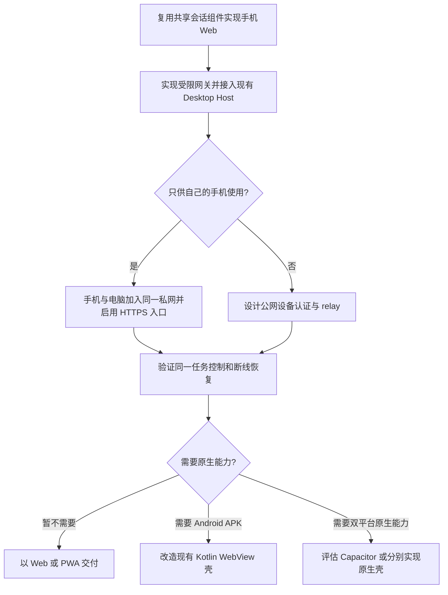
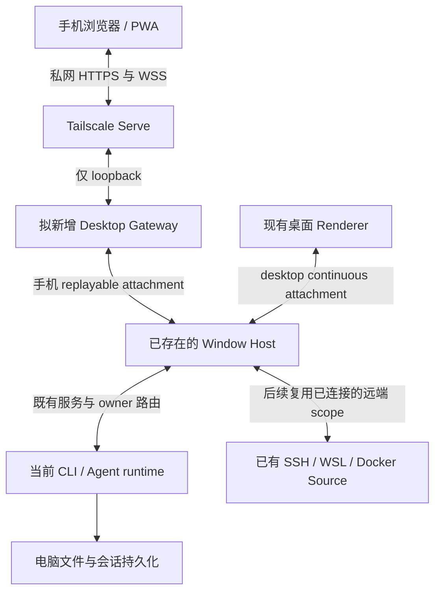
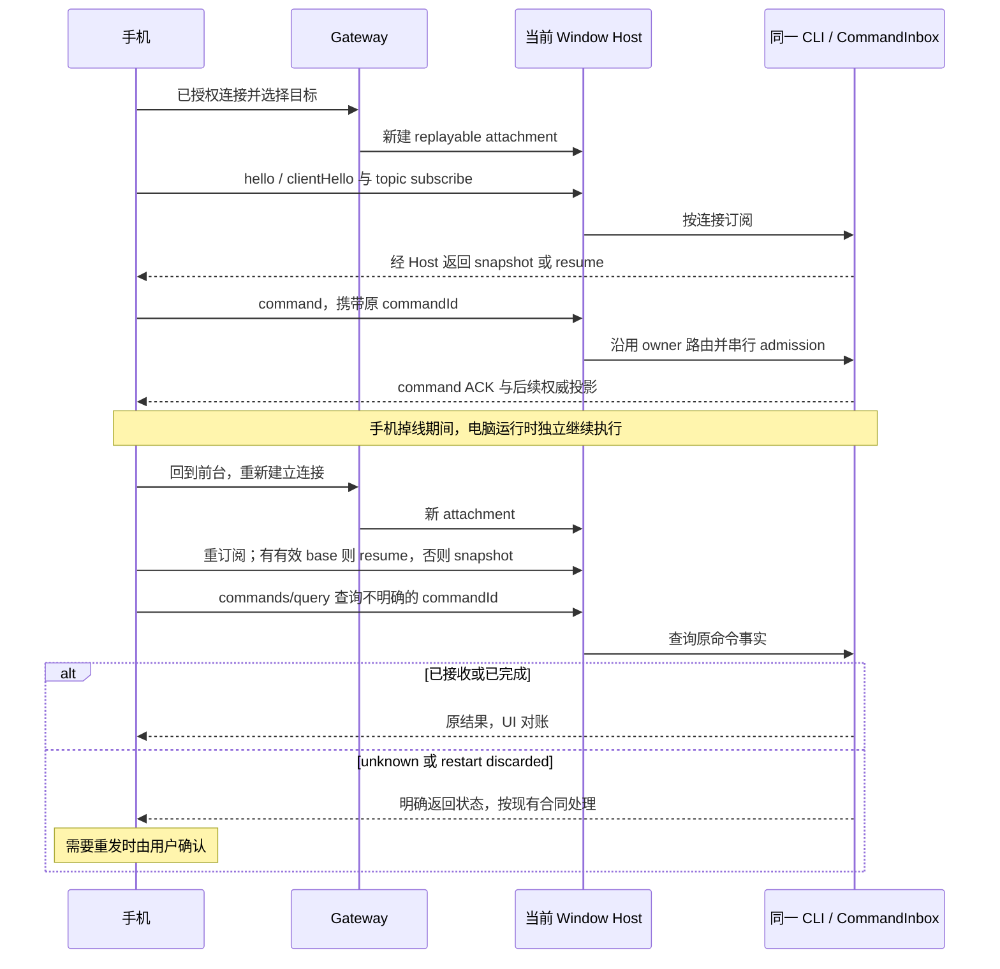
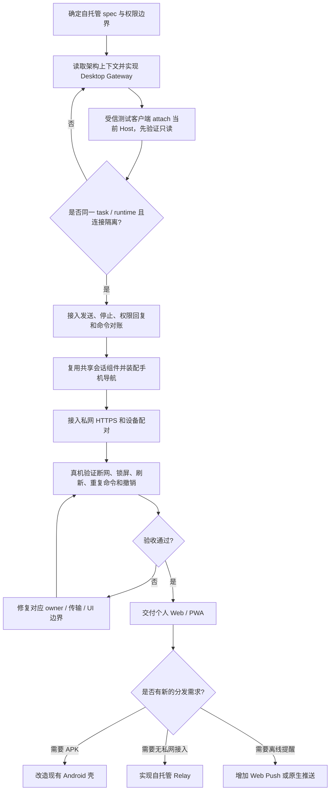

# ZCode 手机端实现与自建方案调研

调研日期：2026-10-30。源码基线：`246cf4dd595db9f5e03732305257f002973e1e80`。目标：手机查看并控制电脑上已有的 ZCode 任务，手机与桌面连接同一 Host/runtime。

本稿由源码调查和官方文档核对形成。下述“现状”指当前检出源码，不代表已安装桌面、手机真机或公网服务的实际验收结果。未改业务代码，未构建 APK，未启动或部署服务。

## 结论与证据分层

针对“用自己的手机控制电脑上的 ZCode”，建议实现一个复用现有会话组件的手机 Web/PWA，为 Desktop 增加受限连接网关，挂接电脑已经存在的 Window Host。个人使用先通过 Tailscale 私网 HTTPS 访问；需要让未安装私网客户端的设备接入时，再增加自托管公网 Relay。这是本次调研建议，尚未实施。

旧手机端采用浏览器薄客户端和 Android WebView 壳，计算、文件操作和 Agent 执行发生在电脑。手机与桌面是连接同一运行时的两个客户端，分别维护自己的导航、草稿和连接状态。核心难点在同一任务的授权、命令接纳与断线恢复，而不在重新写一套 Agent。[历史架构](/Users/openx/github/ZCode/docs/web-remote-control/web-remote-control-architecture.md:5)、[当前 Host 接口](/Users/openx/github/ZCode/packages/desktop/src/host/index.ts:2097)

| 调研对象                                     | 截至当前源码的结论          | 证据边界                                                      |
| -------------------------------------------- | --------------------------- | ------------------------------------------------------------- |
| 官方扫码、账号配对与云 Relay                 | 已从当前桌面产品移除        | 当前 spec 与删除提交共同确认，未探测官方线上服务              |
| 普通 Web + Server                            | 入口与 WebSocket/RPC 仍存在 | 服务于相应 Server 的工作区，不自动接入正在运行的 Desktop Host |
| 同一 Host 的多 attachment 与 replayable 协议 | 保留                        | 是可复用基础，当前没有完整自建手机入口                        |
| Android App                                  | Kotlin + WebView 壳代码保留 | 生产地址仍锁定旧官方入口，未构建或真机验收                    |
| 自建 PWA、桌面网关、设备配对                 | 待开发                      | 本文给出接线方案与验收要求                                    |

### 为什么旧文档与当前源码看起来矛盾

当前独立 Coding Harness spec 明确移除“手机云端远控”，并写明“不新建替代商业服务或手机配对服务”。2026-10-24 的提交 `200426ef30b744425a64e09dce084333927f3b32` 删除了 `webRemoteControlManager.ts`、Web 手机入口编排、V2 transport、OAuth 及多项相关 UI。因此旧远控文档中“本文描述当前有效实现”的文字，必须按该产品变更前的历史说明解读，不能拿旧文档中的命令或环境变量直接启动当前功能。[当前 spec](/Users/openx/github/ZCode/docs/desktop/standalone-coding-harness-spec.md:11)

删除事实通过本地 Git 核对，可只读复查：

```bash
git show --stat 200426ef -- packages/desktop/src/main/webRemoteControlManager.ts packages/web/src
git show '200426ef^:packages/desktop/src/main/webRemoteControlManager.ts'
```

历史代码适合提取生命周期、消息桥接和恢复规则；整包回滚或恢复该提交会同时带回官方登录与商业依赖，也会覆盖之后的独立版演进。自建手机能力需要先新增明确的自托管 spec，说明其独立产品边界。

## 旧手机端的完整工作链路

旧版由五层组成：手机 Web/Android 壳、Relay、Desktop Main、Window Host/业务服务、CLI/runtime。Relay 负责设备与连接配对，Main 转发连接，Host 挂接服务，CLI 执行和保存会话事实。桌面 Renderer 同时直接连接这个 Host。[旧链路及职责](/Users/openx/github/ZCode/docs/web-remote-control/web-remote-control-architecture.md:97)、[共享 Host 规则](/Users/openx/github/ZCode/docs/web-remote-control/task-realtime-sync.md:24)



历史连接过程如下，不能当作现行官方服务的可用性承诺：

1. 桌面使用官方账号 JWT 注册 device，获得 SID；每次连接申请一次性 device token，通过 WebSocket 建连。
2. 二维码只携带设备 SID、路由提示与应用版本；手机以同账号身份申请 terminal token，完成配对。SID 是定位信息，不是登录凭据。
3. 手机请求 bootstrap 与工作区列表，选定已有 workspace，再请求建立 bridge。
4. Main 为目标 Window Host 增加独立 MessagePort attachment，以 RPC 二进制帧承载 service 调用。
5. 手机用 `connectViaProtocol()` 获取与共享 React UI 对应的 services，通过 V4 订阅任务和发送命令。
6. 手机断线只释放该 attachment。电脑继续执行；手机恢复后重新订阅，由 CLI 的 snapshot/resume 恢复状态。

依据：[历史 Relay 身份与配对](/Users/openx/github/ZCode/docs/web-remote-control/relay-v2-pairing.md:44)、[历史 Web 编排](/Users/openx/github/ZCode/docs/web-remote-control/web-remote-control-architecture.md:318)、[当前客户端注入接口](/Users/openx/github/ZCode/packages/client/src/websocket.ts:102)。历史 Android 的“扫码”本质上是打开这个 Web 入口，未把电脑会话迁移到手机运行。

## 当前仍可复用的 Host、RPC 和协议

| 当前实现                                                         | 可以复用的部分                                               | 接入手机时还需要完成的工作                               |
| ---------------------------------------------------------------- | ------------------------------------------------------------ | -------------------------------------------------------- |
| `packages/shared/src/validation.ts`                              | `attach-service-port`、local/remote scope 的严格 schema      | 网关在可信边界构造 scope，不能让网页自选可信 clientMode  |
| `packages/desktop/src/host/windowHostAttachmentRegistry.ts`      | attachment 的替换、关闭、远端换代回收                        | 将手机连接生命周期接到 registry，断线只 detach 自己      |
| `packages/desktop/src/host/index.ts`                             | 现有 services、独立 connection scope、MessagePort 暴露       | 对已存在的窗口 Host 挂一条手机连接                       |
| `packages/services/src/zcode-agent/zcodeAgentConnectionScope.ts` | 每个连接独立订阅所有权与可信上下文                           | 保持手机与桌面的 subscription/buffer 相互隔离            |
| `packages/client/src/websocket.ts`                               | WebSocket 客户端、`connectViaProtocol()` 与 service accessor | 手机 bootstrap、认证、连接重建与 UI 就绪状态             |
| `packages/shared/src/zcode-protocol-v4`                          | hello、snapshot/delta、命令与查询 schema、附件事务           | 手机使用现有协议与投影逻辑，按协商结果启用能力           |
| `packages/shared/src/web-remote-control-rpc-transport.ts`        | 旧 Relay 的严格 fragment schema、编码器和 assembler          | 完整 acknowledged adapter 已删除，不能当成现成运行时引用 |

依据：[attachment schema](/Users/openx/github/ZCode/packages/shared/src/validation.ts:573)、[attachment registry](/Users/openx/github/ZCode/packages/desktop/src/host/windowHostAttachmentRegistry.ts:29)、[可信连接](/Users/openx/github/ZCode/packages/services/src/zcode-agent/zcodeAgentConnectionScope.ts:26)、[RPC transport 原语](/Users/openx/github/ZCode/packages/shared/src/web-remote-control-rpc-transport.ts:10)。当前 renderer reload 本身就复用 `AttachServicePort` 接回存活的 Host，这是“新增客户端不必新增运行时”的实际源码接缝。[窗口 reload 接线](/Users/openx/github/ZCode/packages/desktop/src/main/desktopWindowLifecycle.ts:132)

### 两种交付模式确实不同

当前协议把桌面和 Web/手机分为不同 delivery profile，模式由 Host 注入，不是网页上报后就信任。下面是源码中的默认配置，属于实现参数，不是端到端延迟承诺：

| 项目                                                     | Desktop continuous   | Web/mobile replayable                 |
| -------------------------------------------------------- | -------------------- | ------------------------------------- |
| `flushWindowMs`                                          | 30ms                 | 150ms                                 |
| assistant text 增量                                      | 开启                 | 开启                                  |
| `inputText`、`output.text`、`summaryText` 的 stream path | 开启                 | 关闭                                  |
| 工具进度字段                                             | 关闭该 profile 字段  | 开启该 profile 字段                   |
| 恢复设计                                                 | 保留桌面完整实时链路 | 独立水位、snapshot/resume 与 gap 恢复 |

关闭某个 stream path 不等于最终结果不存在；最终投影仍由现有事件和快照规则决定。手机不能直接复制桌面连续流后无限堆积消息，也不能为了手机省流量改掉桌面主链路。[profile 定义](/Users/openx/github/ZCode/packages/shared/src/zcode-protocol-v4/core.ts:34)、[hello 与 profile 校验](/Users/openx/github/ZCode/packages/shared/src/zcode-protocol-v4/transport.ts:42)

协议命名中的“V4”也不等同于 wire 数字或 App 版本：当前 `V4_WIRE_PROTOCOL_VERSION = 3`，snapshot 的 schema 版本另有定义。版本兼容应读取 hello/capabilities，不能硬编码“V4 就发数字 4”。[版本常量](/Users/openx/github/ZCode/packages/shared/src/zcode-protocol-v4/core.ts:6)

## 当前 Web 入口与手机 UI

`packages/web` 是 React 19 + Vite 8 入口，直接消费 `@zcode/ui`、`@zcode/client` 与 `@zcode/shared`；不是一份独立重写的原生手机会话界面。[源码：package.json](/Users/openx/github/ZCode/packages/web/package.json:14)

当前入口依次完成：

1. 为当前页面生成 `streamClientId`。
2. 普通入口读取 `/api/server-info`，从返回的第一个 workspace 获取路径与 identity。
3. 用同源 `ws://` 或 `wss://` 连接 `/ws`，通过 `connectViaWebSocket` 获得 services。
4. 将 services、Web 版 `IPlatformService`、workspace 信息注入共享 `Root`。

依据：[页面初始化](/Users/openx/github/ZCode/packages/web/src/main.tsx:20)、[地址与 workspace 引导](/Users/openx/github/ZCode/packages/web/src/main.tsx:163)、[Root 装配](/Users/openx/github/ZCode/packages/web/src/main.tsx:197)。Vite 开发入口将 `/ws` 和 `/api` 转发给 server，说明手机浏览器看到的静态页面仍需要实际服务端连接；单独发布静态目录并不会产生 Desktop Host 桥接。[代理配置](/Users/openx/github/ZCode/packages/web/vite.config.ts:42)

仍需区分三个容易混淆的事实：

| 源码事实                                                                   | 实际含义                                                      |
| -------------------------------------------------------------------------- | ------------------------------------------------------------- |
| URL 含 `?remote=<id>` 时仍拼接 `/ws/remote/<id>`                           | 只是前端残留寻址分支，不能据此证明当前 Desktop 已提供手机接入 |
| `connectRemote` 明确返回 `Remote connect is not supported in Web mode yet` | 当前普通 Web 不能创建新的 SSH/WSL/Docker workspace 连接       |
| `Root` 使用 `allowRemoteWorkspace={false}`                                 | 界面也按当前 Web 限制关闭远程 workspace 入口                  |

依据：[Web 平台限制](/Users/openx/github/ZCode/packages/web/src/main.tsx:40)、[残留 remote URL](/Users/openx/github/ZCode/packages/web/src/main.tsx:166)、[Root 开关](/Users/openx/github/ZCode/packages/web/src/main.tsx:208)。是否能控制桌面同一任务，取决于网关是否接入该桌面窗口的 Host，不能从“Web 能打开”推出。

共享 UI 还保留了一些手机适配部件，可以复用设计和逻辑，但不能说已经完整接回现有 Web 入口：

- `RootShell` 使用 `h-dvh`，处理移动浏览器地址栏收放时的动态视口高度。[源码](/Users/openx/github/ZCode/packages/ui/src/root/RootShell.tsx:7)
- `mobileTextInput.ts` 区分 767px 内的窄屏，以及 `hover: none`、`pointer: coarse` 的触屏输入；提供手机 Enter 换行规则，以及固定 16px 输入字号以避免 iOS 聚焦缩放。[源码](/Users/openx/github/ZCode/packages/ui/src/lib/mobileTextInput.ts:3)
- `ConversationComposer` 仍根据 `isWebRemoteControl` 接入上述输入规则、短 placeholder 和 iOS 输入字号。[源码](/Users/openx/github/ZCode/packages/ui/src/v4/ConversationComposer.tsx:683)
- 但当前 `WorkspaceShellLayout` 给主会话传入 `compactForRemoteControl={false}`，侧面板 `mobileOverlay`、`mobileStacked` 也固定为 `false`。因此手机专用会话布局需要重新明确装配点，不宜只靠 CSS 把整个桌面界面缩小。[主会话接线](/Users/openx/github/ZCode/packages/ui/src/app-shell/WorkspaceShellLayout.tsx:1937)、[侧面板接线](/Users/openx/github/ZCode/packages/ui/src/app-shell/WorkspaceShellLayout.tsx:1542)
- `components/mobile-ui` 的 BottomSheet、品牌与设备图标不持有认证或设备状态，适合继续作为纯展示组件复用。[组件契约](/Users/openx/github/ZCode/packages/ui/src/components/mobile-ui/CONTRACT.md:1)

## Android 壳实际做了什么

仓库确实存在 `packages/android`，采用 Kotlin、Jetpack Compose 和系统 `WebView`，不是 Capacitor、React Native 或 Flutter。Compose 提供启动页、扫码页、最近连接、顶部加载与错误界面，远控业务内容由 WebView 加载远端网页。[依赖与构建](/Users/openx/github/ZCode/packages/android/app/build.gradle.kts:1)、[WebView 创建](/Users/openx/github/ZCode/packages/android/app/src/main/java/com/example/zcode_mobile/ui/RemoteControlApp.kt:682)

| 能力          | 源码现状                                                 | 自建时的含义                                     |
| ------------- | -------------------------------------------------------- | ------------------------------------------------ |
| 扫码          | CameraX + ML Kit，仅识别 QR Code                         | 可以复用，但二维码应改为自建配对入口             |
| deep link     | `zcode://remote` 和官方 `/remote` HTTPS URL              | 自建品牌、路由和 origin 需要重新配置             |
| 最近连接      | 私有 SharedPreferences，保留最近 5 条完整 URL            | 不能直接把含永久令牌的 URL 当作连接历史          |
| 页面安全      | JS/DOM storage 开启；文件/content 访问关闭；禁止混合内容 | 维持受信 origin，避免变成任意网页的原生权限入口  |
| 前台服务      | `dataSync` 类型通知，`START_NOT_STICKY`                  | 是进程保活提示，不承诺后台 JS 或 socket 永久在线 |
| 屏幕常亮      | 打开页面时设置，关闭远控时清理                           | 仅改善前台使用，不解决锁屏、进程回收或电脑休眠   |
| 业务推送      | 未发现 FCM、推送 token 注册或原生任务事件接收实现        | 现有通知是保活通知，不能当作任务完成推送         |
| Agent/runtime | Android 壳没有独立 Agent、Host 或 SSH runtime            | 手机始终是薄客户端                               |

依据：[扫码](/Users/openx/github/ZCode/packages/android/app/src/main/java/com/example/zcode_mobile/ui/RemoteControlApp.kt:234)、[Manifest](/Users/openx/github/ZCode/packages/android/app/src/main/AndroidManifest.xml:5)、[历史存储](/Users/openx/github/ZCode/packages/android/app/src/main/java/com/example/zcode_mobile/remote/RemoteControlRecentLinksStore.kt:15)、[WebView 配置](/Users/openx/github/ZCode/packages/android/app/src/main/java/com/example/zcode_mobile/ui/RemoteControlApp.kt:695)、[保活服务](/Users/openx/github/ZCode/packages/android/app/src/main/java/com/example/zcode_mobile/remote/RemoteControlKeepAliveService.kt:20)、[Activity](/Users/openx/github/ZCode/packages/android/app/src/main/java/com/example/zcode_mobile/MainActivity.kt:62)。

生产包允许的网页 origin/route 目前硬编码为 `https://zcode.z.ai/remote...`；debug 才放开 localhost 和部分局域网地址。只修改图标、包名并编译 APK，仍会走官方旧入口，无法自动连到自建 Desktop 网关。[URL 白名单](/Users/openx/github/ZCode/packages/android/app/src/main/java/com/example/zcode_mobile/remote/RemoteControlUrlPolicy.kt:48)、[默认 URL](/Users/openx/github/ZCode/packages/android/app/build.gradle.kts:15)

`docs/mobile-remote-control-android.md` 描述 Android 依赖现有 `/remote`、relay 和 `web-remote-replayable`。它应作为历史实现说明阅读：当前独立桌面 spec 明确移除官方手机云端远控，并且本次未验证官方域名服务是否仍可用。Android 目录存在，不等于旧产品链路仍被当前桌面装配。[旧壳说明](/Users/openx/github/ZCode/docs/mobile-remote-control-android.md:1)、[当前产品边界](/Users/openx/github/ZCode/docs/desktop/standalone-coding-harness-spec.md:5)

另一个具体缺口：当前 Android `targetSdk = 36`，保活服务使用 `dataSync`，未实现 `Service.onTimeout`。Android 官方规定，对 target Android 15 及以上的 App，此类前台服务后台运行累计受 24 小时内 6 小时限制；超时需要停止服务。这不是已复现故障，但意味着该壳不能作为无限后台保活方案。[targetSdk](/Users/openx/github/ZCode/packages/android/app/build.gradle.kts:15)、[官方前台服务超时规则](https://developer.android.com/develop/background-work/services/fgs/timeout)

## PWA、后台恢复与推送

本次在 `packages/web`、Android 和共享 UI 的相关入口中未找到 PWA manifest、service worker 注册、`PushManager` 订阅或 Web Push 接收链路；当前 Web 通知仅在浏览器已有 `Notification.permission === "granted"` 时调用 `new Notification`，没有接入关闭页面后的推送投递。[Web 通知](/Users/openx/github/ZCode/packages/web/src/main.tsx:87)

PWA 可以作为第一版交付形式，但需要区分：

- “添加到主屏幕”或浏览器支持安装网站，不等于应用已经具备离线数据、后台执行和可靠推送。manifest 用于定义图标、入口、显示模式等；service worker 适合缓存和 Web Push，但不是所有浏览器安装行为的强制前提。[MDN：PWA 安装条件](https://developer.mozilla.org/en-US/docs/Web/Progressive_web_apps/Guides/Making_PWAs_installable)
- 浏览器隐藏、冻结或回收页面时，JS timers、fetch callbacks 等可以暂停。不能把持续心跳和页面 WebSocket 当作后台任务事实源；恢复时要重新鉴权、恢复订阅并按服务端序号或 snapshot 对齐。[Chrome：Page Lifecycle API](https://developer.chrome.com/docs/web-platform/page-lifecycle-api)
- iOS/iPadOS 16.4 起，添加到主屏幕的 Web App 支持 Web Push，组合使用 Push API、Notifications API 和 Service Workers；授权请求必须来自用户直接交互。WebKit 明确不要求为了 Web Push 加入 Apple Developer Program。[WebKit：Web Push](https://webkit.org/blog/13878/web-push-for-web-apps-on-ios-and-ipados/)
- Web Push 解决任务完成或等待批准的提醒，不负责保存 Agent 执行状态。用户点通知后，仍应回到 Host 查询最新状态。

建议第一版把“手机离线时电脑继续执行；手机回来后可完整恢复”设为产品合同，把“手机 socket 一直活着”排除出正确性前提。若还需要关闭页面后的任务提醒，再增加 Web Push 或原生推送投递。这是建议，当前仓库尚未完成自建链路。

## 手机交付形式比较

| 形式                                    | 复用程度                                   | 主要新增工作                                                                   | 对本目标的判断                         |
| --------------------------------------- | ------------------------------------------ | ------------------------------------------------------------------------------ | -------------------------------------- |
| 响应式 Web / PWA                        | 最高，可复用共享会话组件、类型、客户端 SDK | 手机导航、认证配对、连接恢复、manifest；需要通知时补 service worker 与推送后端 | 适合先验证同一 Desktop Host 的控制链路 |
| 现有 Kotlin + WebView 壳                | 可保留扫码、最近连接、原生加载/返回逻辑    | 改受信地址、配对 token 存储、网络恢复；按实际需要处理通知与后台限制            | Android 用户需要 APK 时优先评估        |
| Capacitor + React Web                   | 可复用 Web UI，补 iOS/Android 原生插件     | 新增壳工程、插件权限、构建签名与商店流程                                       | 双平台确有原生能力需求时再考虑         |
| React Native / Flutter / 原生重写会话页 | 复用协议和后端，React DOM 组件复用有限     | 重新实现富文本、工具卡、diff、权限弹窗、流事件投影与平台适配                   | 第一版成本偏高，不能替代 Host 桥接     |

Capacitor 官方将其定位为为 Web 应用提供 iOS/Android 等平台原生 runtime 与插件 API；它解决原生打包与能力访问，不能自动提供 Desktop Host 连接、任务同步或移动后台永续运行。[Capacitor 官方说明](https://capacitorjs.com/docs)

## 自用联网方式

如果目标只是自己的手机控制自己的电脑，可优先考虑手机与电脑加入同一 Tailscale 网络，电脑上仅监听 loopback 的自建手机网关由 Tailscale Serve 提供 HTTPS 访问。官方文档说明 Serve 向 tailnet 内其他设备发布本机服务；它与公开暴露的 Funnel 不同。[Tailscale Serve](https://tailscale.com/kb/1312/serve)



私网和 HTTPS 解决网络可达与传输保护；它们不会自行注入 Desktop Host services、代替命令授权、处理窗口 owner/lease，也不会让休眠或已退出的桌面进程继续运行。若信任 Serve 的身份头做授权，官方要求后端仅监听 localhost，避免其他入口伪造同名头绕过代理。

## 推荐自建架构：PWA 加 Desktop Gateway

第一版的新增边界是一个 Desktop Gateway：负责静态手机页入口、配对、浏览器连接以及 MessagePort 桥接，服务和执行继续归已有 Host/CLI。Gateway 是本文提出的组件名，当前仓库没有现成的同名手机服务或可直接执行的启动命令。



### Desktop 侧如何接

1. 在桌面增加用户主动开启的手机连接入口，绑定目标窗口；展示地址、配对状态和撤销设备动作。
2. Gateway 只监听 loopback，由私网 HTTPS 代理提供手机可达地址。配对完成之前，不创建任何 workspace attachment。
3. 从现有 `windowHostProcessMap` 取得该窗口已经运行的 Host，新建 MessageChannel，用 `AttachServicePort` 将一端交给 Host。由可信 Desktop 端固定 `clientMode: "web-remote-replayable"`。
4. 手机 WebSocket 的协议适配器连接另一端 MessagePort。Main/Gateway 只转发连接和消息，不读取任务库、不拼接 assistant 正文、不建立第二个已接纳输入队列。
5. WebSocket 关闭时释放对应 attachment；窗口真正关闭或应用退出时才按现有生命周期回收 Host。手机断线不能杀掉 CLI，旧连接迟到结果不能恢复被撤销的 attachment。

这些操作的现有接缝见：[窗口 Host 复用](/Users/openx/github/ZCode/packages/desktop/src/main/desktopWindowLifecycle.ts:139)、[Host attach 分支](/Users/openx/github/ZCode/packages/desktop/src/host/index.ts:3091)、[关闭与替换语义](/Users/openx/github/ZCode/packages/desktop/src/host/windowHostAttachmentRegistry.ts:57)。涉及 Main、Host、Shared、Web/UI 的实际实现前，应执行仓库架构检查并读取各目标模块的受控上下文；本文未修改这些模块。

### 手机侧如何接

手机入口负责“连接页 → 任务列表 → 会话页”三种主要状态；复用共享会话、工具卡、权限交互和附件协议，手机自己保存草稿、滚动与导航。先完成 service accessor 注入和移动布局装配，再补主屏幕图标、manifest 与安装体验。运行中显示只读/重连状态，不能把 socket open 直接当作业务 ready。

`IMessagePassingProtocol` 是合适的传输接缝：它只要求发送 `VSBuffer`、订阅 `onMessage`，上层通过 `connectViaProtocol()` 取得原有 services，不需要重写每个 task RPC。[协议接口](/Users/openx/github/ZCode/packages/rpc/src/protocol.ts:24)、[客户端装配](/Users/openx/github/ZCode/packages/client/src/websocket.ts:102)

有一个具体的接线陷阱：现有 `connectViaWebSocket()` 使用 `SocketProtocol`，在消息外添加 socket 帧头；`MessagePortProtocol` 直接发送 Channel 消息，没有同样的帧头。因此不能把两边收到的原始 bytes 无条件互相 `postMessage/send`。应在 `IMessagePassingProtocol` 的已解帧消息层桥接，或者为手机另写双方一致的 raw-message WebSocket adapter，再交给 `connectViaProtocol()`。选择一种消息封装，避免双重编码和双重重放。[WebSocket 适配](/Users/openx/github/ZCode/packages/client/src/websocket.ts:93)、[socket framing](/Users/openx/github/ZCode/packages/rpc/src/protocol.ts:234)、[MessagePort framing](/Users/openx/github/ZCode/packages/rpc/src/protocol.ts:358)

### 为什么不能直接启动普通 Server 就算完成

当前 Server 的 `/ws` 会为其自身 ServiceCollection 创建 replayable connection scope；它没有“找到已经打开的 Electron 窗口并接管其 Host”的逻辑。`pnpm dev:web` 启动的是 server + web 两个开发入口，适合验证普通 Server Web，而不是本目标的同一 Desktop 任务控制。[根命令](/Users/openx/github/ZCode/package.json:8)、[Server channel 装配](/Users/openx/github/ZCode/packages/server/src/http.ts:89)

当前 `/ws/host` 也不是手机接入地址：它用于受信 Host relay，需要先申请短期、一次性 capability，再用对应 header 消费；普通 `/ws` 的旧 mode header 不能提权。这个 capability 是 Server 受信连接的技术边界，不等同于用户对手机的设备授权。[Server 路由](/Users/openx/github/ZCode/packages/server/src/http.ts:364)、[capability 实现](/Users/openx/github/ZCode/packages/server/src/hostCapability.ts:4)

旧 `/api/connect-remote`、`/ws/remote/:id` 被退出是为了避免在 Server 里另起临时 runtime，绕过 Window Host 主链。当前 Web 仍保留的 `?remote=` 地址拼接不构成可用方案。[退出原因](/Users/openx/github/ZCode/packages/server/src/http.ts:450)

## 设备授权与能力边界

个人私网方案可以省掉官方账号系统，但仍要明确哪台手机获得哪个窗口的控制权。建议桌面显示短时、一次性的配对二维码；手机通过 HTTPS 兑换设备会话，桌面可撤销。长期凭据留在受控会话或 App 私有安全存储，二维码和最近连接只保留必要的临时定位信息。TTL、设备数和重启后的信任保留方式应先写入 spec，本文不把它们假定为已实现。

浏览器可以使用同源 `Secure`、`HttpOnly` 会话 cookie，并对配对、变更请求和 WebSocket upgrade 校验 Origin；原生壳则需要适合其 WebView/系统存储的明确凭据方案。不要直接照抄当前独立 Server 的长期 token query 登录作为公开手机产品：现有实现接受 URL query token、Bearer 或 cookie，是另一套用途的接口。[现有 token 处理](/Users/openx/github/ZCode/packages/server/src/http.ts:243)

同样需要区分“隐藏按钮”和“拒绝 RPC”。当前 Host 为 replayable attachment 使用显式 channel allowlist，Terminal 与 Source settings 不会因为复用 UI 自动开放；但现有 allowlist 仍包括文件、设置和 Credential 等较强服务。自建入口必须按第一版实际能力审阅，而不能把这份历史策略视为已经满足新设备授权模型。[现有暴露策略](/Users/openx/github/ZCode/packages/desktop/src/host/windowHostAttachmentRpcPolicy.ts:16)

当前 `ServiceExposurePolicy` 只按 channel 过滤，没有现成的通用 method/path 权限表达。`local` scope 只有 `{kind: "local"}`，不能据此宣称已经把本地所有 RPC 限制在一个目录。如果产品承诺“只允许这个 workspace”，需要服务侧验证每次调用的目标并沿用现有身份工具；界面选中某个目录或二维码携带 workspace 字段不构成权限隔离。[策略类型](/Users/openx/github/ZCode/packages/services/src/collection.ts:4)、[scope schema](/Users/openx/github/ZCode/packages/shared/src/validation.ts:573)

第一版可只开放任务列表、会话阅读、发送、停止及当前任务权限回复；终端、凭据管理、系统设置等能力按需另行评审。权限回复绑定当前 task/run/interaction，已在电脑上处理过的请求必须在手机上失效，不能因重复点击再执行一次。

## 恢复与一致性是第一版的必要部分

正常读会话时，手机先完成 hello/clientHello，订阅对应 topic。若手机确实持有一致的 `{logEpoch, seq}` 状态，可以请求 resume；否则接收完整 snapshot。`fromSeq` 断档触发 resync，runtime epoch 改变或 base 无效时回到 snapshot。snapshot 完整装配后整体应用，不允许一边缺片一边把部分旧状态拼上去。[订阅 schema](/Users/openx/github/ZCode/packages/shared/src/zcode-protocol-v4/transport.ts:110)、[恢复合同](/Users/openx/github/ZCode/docs/web-remote-control/task-realtime-sync.md:100)

发送侧必须分清三个阶段：WebSocket 接受 bytes、CLI command ACK、任务执行完成。前者不证明后两者。复用现有 `commandId` 与查询合同，ACK 不明确时用 `commands/query` 对账，而不是生成新 ID 自动重发。[ACK 与查询 schema](/Users/openx/github/ZCode/packages/shared/src/zcode-protocol-v4/command.ts:438)



CLI 的 `CommandInbox` 是已接纳输入的唯一队列；手机和桌面同时提交时，以 CLI 串行 admission 为准。Renderer 只保存草稿与待对账展示，Gateway 不保存第二份 accepted queue。网络断线和 CLI 重启是不同故障：当前合同不承诺未进入 transcript 的排队输入跨 CLI 进程继续执行，重启后按 discarded ledger 收口，不能用自建网关偷偷重放来改变语义。[队列与重启边界](/Users/openx/github/ZCode/docs/web-remote-control-task-command-queue.md:75)

数据量同样需要显式预算。当前 V4 单物理帧默认上限 1MiB，logical frame 16MiB；topic 级 assembler 和旧 Relay raw transport 的分片上限是两层不同规则，不能混用。浏览器标准 WebSocket API 没有接收背压接口，`bufferedAmount` 也不是对端已消费 ACK。应复用现有有界缓冲、连接级 saturated/drained 和 snapshot 恢复机制，避免慢手机拖住桌面或无限积攒历史。[V4 限额](/Users/openx/github/ZCode/packages/shared/src/zcode-protocol-v4/core.ts:64)、[Host 流控](/Users/openx/github/ZCode/packages/desktop/src/host/index.ts:2175)、[MDN WebSocket](https://developer.mozilla.org/en-US/docs/Web/API/WebSocket)

直连 WebSocket 第一版可以在断线后重建 attachment、恢复 V4 订阅并查询命令，不必为了沿用历史协议立即恢复整套 Relay JSON/base64 ACK 封装。需要公网 Relay 的有界重放时，再明确复用哪些 fragment/ACK 原语；传输重放和命令幂等必须保持各自职责。

## 公网 Relay 什么时候值得做

需要手机不装私网客户端、跨网络扫码即用，或管理多台电脑时，自托管 Relay 才有明确收益。Desktop 主动向公网 Relay 建立出站 WSS，手机也连接同一 Relay；Relay 按配对身份转发，避免要求电脑有公网 IP。这属于拟新增能力，当前仓库保留的 shared schema 和测试资料不是完整生产 Relay 服务。

应从历史 V2 提取：一次性连接 token、设备与 terminal 身份、同角色 owner 替换、旧连接 close 不得移除新 owner、心跳超时、带抖动重连、消息限额。账号系统可以替换为自托管设备授权，Relay 仍不保存 task、正文、queue 或 snapshot。多用户发行才需要进一步设计用户归属和设备管理，不应先恢复官方 JWT/OAuth 接口来满足个人自用。[历史 Relay 合同与边界](/Users/openx/github/ZCode/docs/web-remote-control/relay-v2-pairing.md:63)

两段 WSS 保护“手机到 Relay”和“Relay 到电脑”，不自动构成手机到电脑的端到端加密。若 Relay 被要求看不到会话内容，需要单独的端到端密钥与消息保护设计。个人私网方案可以先减少这层公网服务依赖。

## 外部引擎与原生终端要分开验收

当前外部 Agent 引擎集成把 Claude Code / Codex adapter 事件翻译为统一 V4 projection，因此自建手机接入同一 Host 后，设计上可以复用对应聊天、工具和权限 UI；实际支持范围仍以 session capability 为准，需要单独验证，不能假定所有原生 CLI 功能都已暴露。[外部引擎状态所有者](/Users/openx/github/ZCode/docs/desktop/external-agent-engines-spec.md:49)

“在 ZCode 终端里运行原生 Claude Code”是另一条 PTY/TUI 路径，其登录、历史、交互和权限在原生终端内完成，没有自动变成 ZCode 会话气泡。由于手机 replayable 策略默认不暴露通用终端，这条能力不会随聊天远控接入自动可用；如确需手机终端，要独立设计 PTY capability、输入/resize 与生命周期。[原生终端规则](/Users/openx/github/ZCode/docs/desktop/claude-code-native-terminal-spec.md:5)、[手机 channel 策略](/Users/openx/github/ZCode/packages/desktop/src/host/windowHostAttachmentRpcPolicy.ts:67)

## 开发顺序与验收门槛

以下是拟议实施路线，不是本次已经执行的开发计划。先写自托管手机 spec，明确唯一状态所有者、设备授权、支持能力、同一桌面任务身份和恢复合同，再改业务代码。



第一版建议覆盖：连接指定电脑窗口、浏览既有项目与任务、查看消息和工具结果、发送与停止、回复当前权限请求、断网恢复，以及在电脑侧撤销手机。远端 scope、多电脑管理、终端、文件编辑和推送按需要逐步增加。

| 验收场景                              | 应有结果                                                                     |
| ------------------------------------- | ---------------------------------------------------------------------------- |
| 手机打开桌面正在运行的任务            | 同一 taskId 和 runtime，内容一致，不启动第二次模型调用                       |
| 手机和电脑同时发送                    | CLI 串行接纳，每条输入只执行一次                                             |
| 发送后立即断网，ACK 丢失              | 重连查询原 commandId，明确已接收/失败/未知，不自动双发                       |
| 锁屏后电脑执行完毕，手机回前台        | 获取最新 snapshot，工具、权限、队列与终态一致                                |
| 同一权限请求在电脑先处理              | 手机旧卡失效，重复回复不能产生第二次副作用                                   |
| 手机连接很慢或大历史会话              | 有界缓冲、分片或 snapshot 恢复，桌面持续正常接收                             |
| 手机刷新、断线或关闭页面              | 只释放手机 attachment，电脑任务继续                                          |
| 桌面 renderer reload                  | 接回现有 Host；手机连接恢复不另建 runtime                                    |
| 桌面真正关窗、退出或电脑休眠          | 显示正确离线状态，不承诺后台继续执行                                         |
| 撤销设备、配对码重放、伪造 clientMode | 连接被拒绝或关闭，不能读写任务                                               |
| 后续接入远端 workspace                | 验证 identity、path、remoteSessionId 和当前 generation，不跨机器同路径串会话 |
| 移动端体验                            | iOS/Android 软键盘、中文输入、Enter 换行、旋转、返回键、长会话滚动可用       |

远端路径的依据是当前 Host registry 对 `remoteSessionId + workspacePath + workspaceIdentity` 的一致性校验；同路径不代表同工作区。授权、测试和缓存都必须保留 identity 语义。[远端 scope 校验](/Users/openx/github/ZCode/packages/desktop/src/host/windowRemoteConnectionRegistry.ts:1538)

电脑是运行事实源，因此需要电脑保持唤醒、应用与对应窗口 Host 仍运行。如果最终要求“电脑退出或休眠，任务依旧全天运行”，需要改为常驻服务器或 daemon 的执行模型，属于另一项架构目标，PWA、Android 前台服务和 Relay 都不能单独做到。

## 本次实际验证

- 基线检查：`node scripts/check-workspace-freshness.mjs` 已按脚本默认执行 `git fetch origin --prune`，检查时 main 相对 `origin/main` ahead 0 / behind 0。
- 当前检出提交：`246cf4dd595db9f5e03732305257f002973e1e80`。调查时工作区已有 4 个修改文件，全部保留；本次仅新增本报告。
- 使用当前 Node `v24.14.0` 和仓库固定的 pnpm：`npx --yes pnpm@10.33.2 typecheck` 通过；`npx --yes pnpm@10.33.2 lint` 为 0 errors / 93 warnings。未将这些静态检查当作手机链路验收。
- 未修改 spec 产品行为或业务源码，未启动桌面/Server，未部署网关或 Relay，未执行手机真机、模型调用、通知送达或 Android 构建验收。

## 外部资料获取记录

以下来源均于 2026-10-30 通过 HTTPS 获取并核对正文，未借助二手文章推断功能。未进行手机真机、通知送达、Tailscale 私网连通或前台服务超时复现。

| 官方来源                                                                                                                        | 本文使用的结论                                                           |
| ------------------------------------------------------------------------------------------------------------------------------- | ------------------------------------------------------------------------ |
| [Chrome Page Lifecycle API](https://developer.chrome.com/docs/web-platform/page-lifecycle-api)                                  | 页面可冻结或被回收，不能依赖持续后台 JS                                  |
| [WebKit Web Push for Web Apps on iOS and iPadOS](https://webkit.org/blog/13878/web-push-for-web-apps-on-ios-and-ipados/)        | iOS 16.4 主屏 Web App 的 Push、授权与 Developer Program 条件             |
| [Android Foreground service timeouts](https://developer.android.com/develop/background-work/services/fgs/timeout)               | target Android 15+ 的 dataSync 后台时间限制与 onTimeout                  |
| [Android Build web apps in WebView](https://developer.android.com/develop/ui/views/layout/webapps/webview)                      | WebView 是承载网页的原生 View，JS、导航和安全边界须显式处理              |
| [Capacitor 官方文档](https://capacitorjs.com/docs)                                                                              | Web UI 与原生 runtime、插件的职责                                        |
| [Tailscale Serve](https://tailscale.com/kb/1312/serve)                                                                          | 私网发布本机服务、HTTPS、与 Funnel 的区别、身份头信任前提                |
| [MDN Making PWAs installable](https://developer.mozilla.org/en-US/docs/Web/Progressive_web_apps/Guides/Making_PWAs_installable) | manifest/HTTPS/安装行为；service worker 不应被笼统说成所有安装的必要条件 |
| [MDN WebSocket](https://developer.mozilla.org/en-US/docs/Web/API/WebSocket)                                                     | 标准 API 无接收背压，不能把发送缓存量视为消费确认                        |
