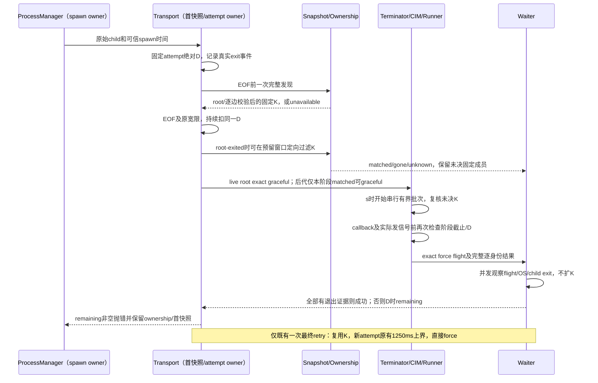

# Windows Agent 进程树清理状态机

## 背景

桌面 Host 会为每个 workspace 启动 Agent CLI。关闭 workspace、重启 runtime、Computer
Use Helper 凭据轮换以及 App 退出时，都必须回收 Agent 根进程与它派生的 runtime/MCP
后代。Windows 通过首次合法快照固定候选，再以当前创建身份复核和 exact PID 命令清理。
本 services/process 调用链所有 graceful、force 和 root 例外均禁止 `taskkill /T`。
2026-11-17 的当前合同如下；文末旧验证记录仅证明当时实现，不证明本次安全修复已通过。

现有等待路径如下，禁止新增第二套等待语义：

```text
ZCodeAgentProcessManager
  -> ZCodeProtocolClient.disposeAndWait
  -> ZCodeStdioTransport.disposeAndWait
  -> terminateProcessTreeAndWait
  -> waitForProcessTreeTermination
```

非等待式 `terminateProcessTree` 仍用于 best-effort dispose；等待式调用必须在同一条路径
内取得并观察 taskkill flight。

## 历史缺陷与本次范围

此前运行时日志确认了三个互相叠加的竞态（下列 `/T` 是当时命令）：

1. 等待式回收启动 graceful `taskkill /T` 后没有暴露其 flight，等待器无法观察命令完成；
2. `taskkill /F` 已成功且 OS PID 已消失时，Node `ChildProcess.exit` 可能晚 1-10 ms 投递；
   等待器返回成功后，transport 又用滞后的 `exitCode` 把 root PID 追加回残留结果；
3. 多 workspace 共用的进程表查询可能早于新 Agent spawn 启动。新 root 的 cleanup 若复用
   这张旧表会查不到自身，随后正确地 fail-closed，却也因此无法发送 taskkill。

2026-11-17 的 Task26 又确认了陈旧 PPID 碰撞：旧进程保留的 parent PID 被新 Agent 复用，
只沿 PPID 发现会误归属；原生 `/T` 还会绕过快照过滤再次扩树。本次仅关闭该可达缺口及其
必要的短预算、身份编码、未知结果问题，不修改其它 CLI taskkill、POSIX 组或远端语义。

## 所有者与固定集合

| 状态                                                            | 唯一所有者/职责                                           |
| --------------------------------------------------------------- | --------------------------------------------------------- |
| 原始 spawn ChildProcess、可信 spawn 起点                        | ProcessManager；其余已有 caller 传入自己的原始 spawn 对象 |
| 首快照、真实 exit 事件时间、cleanup attempt、transport deadline | StdioTransport；最终 retry 复用同一首快照                 |
| 固定成员的解析及本阶段匹配证据                                  | 现有 Ownership / Snapshot；只派生，不建第二接受状态       |
| 验证、信号与 flight 调度                                        | 现有 Terminator；Windows CIM 适配器执行有界查询           |
| 终态、remainingPids 与唯一完成 Promise                          | 现有 Waiter；Manager 仅在确认完成后释放 ownership         |
| 单 PID 命令                                                     | 现有 WindowsTaskkillRunner，生产仍为异步 execFile         |

固定候选 `K` 是首次合法发现的 `(pid, CreationDate)` 集合，跨 EOF、reparent 和最终 retry
不扩大。当前匹配集合 `M(stage)` 只是该阶段查询证据；`M=[]` 不等于 `K` 已退出。
未知集合与已证明退出集合是同一 attempt 内对 `K` 的派生结果，不是新 owner、缓存或第二写入路径。
已登记身份 reparent 后仍按创建身份复核，不重新要求当前 PPID 等于旧 parent。

Windows sync/async 的创建标识统一为 `windows-utc-100ns:<unixTicks>`，其中
`unixTicks = BigInt(rawDotNetTicks) - 621355968000000000n`；输入须为可解析的非负十进制
整数且位于 .NET DateTime ticks 范围 `0..3155378975999999999`。保留原输出的全部精度，不经 Number/ms 截断。
这是同一 CIM 来源的表示统一，来源只有微秒时不凭编码增加精度；不为未发现的持久化旧 token
增加兼容路径。sync snapshot → async filter/force 必须匹配同一编码。

首次发现先校验 root：PID 有效且唯一、创建时间可解析；有可信 spawn 时创建时间不得更早。
沿每个实际父身份递归要求 `child.created >= parent.created`，相等允许，无 epsilon。
同 PID 重复行（包括完全相同的重复）、环上节点及其依赖分支不参与认领；root 发生歧义时整张
快照 unavailable。不可解析的中间节点不能被丢行后通过别的路径重新认领，禁止穿透被拒分支。

root 已退出或同轮查询期间观察到 exit 时，不用当前同 PID 行作为 root。仅使用真实事件的
`[spawn, exit)`：两个毫秒边界为非负安全整数且 `spawn < exit`，转为 BigInt 后乘 `10000n`
比较。所有恢复候选（包括孙代）均留在该区间；直接 child 以生命周期下界锚定，后续逐边校验。
无可信上界则不恢复；query completion 不能代替 exit。同步调用前后检查已知 exit，不能宣称
消除了同步阻塞期间尚未投递 exit 的盲区。

## 内部验证结果与完成合同

现有内部调用须携带逐身份结果及原因，名称可按实现收敛；公开
`ProcessTreeTerminationResult` 仍只有既有 `remainingPids`，不新增公开 API。

| 结果    | 可接受的证据                                                                                              | 发信号/观察含义                                      |
| ------- | --------------------------------------------------------------------------------------------------------- | ---------------------------------------------------- |
| matched | 本阶段成功、完整、无歧义的定向批次中 PID 与 canonical CreationDate 同时匹配                               | 仅准入本阶段 exact PID 信号，仍需真正发出前核截止    |
| gone    | 完整成功批次中该 PID 无行或创建身份明确不同；或 OS 探测明确 ESRCH；原 root 的真实 exit 也可证明 root gone | 原身份退出，不信任/不跟踪该 PID 的新对象，不再发信号 |
| unknown | 查询失败/超时/权限拒绝、行不可解析/重复/截断、未查询、预算耗尽、OS 探测非 ESRCH 错误                      | 不准入信号，继续保留固定成员的观察责任               |

空 stdout 只有在命令明确成功且输出完整时才表示该定向集合为空；命令失败不能等同于空结果。
输出含意外 PID 或不能归属的坏行时，该批次不能证明任何未返回身份 gone；保守返回该批 unknown。
单项明确坏行只使该项 unknown，合法唯一匹配项可保留；不得用 Map 后写覆盖隐藏重复身份。

初始 root-exited 过滤必须返回这些内部结果：查询全失败时保留 `K` 为 unknown，并为其保留
验证/命令预算。Waiter 跟踪的是尚未证明 gone 的固定身份，不仅是 matched；force 回调不能
用 matched 子集覆盖并丢弃 unknown。`process.kill(pid, 0)` 的 true 只表示存在，不授权信号；
EPERM 等错误是 unknown，不能像 ESRCH 一样清空 remaining。查询 false 的布尔接口不能作为
本链的完成判据；现有公开数组过滤接口可保持外形，内部清理须消费完整结果。

root 的原始 ChildProcess exit 只解决 root，不解决 known descendants。首次发现完全 unavailable
且从未取得合法成员时，沿既有 unverifiedRootOnly 观察原 ChildProcess：只有它的明确退出/不存在
证据可完成这个有限观察责任，不将 timeout 当成功，也不声称未知后代均已回收。

截止时，仍存在或无法确认退出的固定身份去重进入 `remainingPids`，并继续阻止 ownership 释放。
日志分别记录 confirmed-live 与 unresolved，不能把未知说成已证存活。命令成功也不是退出证据。

## 安全不变量

1. live root 仅对调用链传入的原始受管 spawn ChildProcess 发 exact graceful。旧快照中的
   descendant 不得直接发 graceful；root 已退出时只有本阶段 matched 后代可发 graceful。
2. force 对固定且未证明 gone 的 root/descendant 做本阶段复核，matched 才发 exact `/F`。
   原受管 live root 是唯一既有例外：没有 unavailable/unverifiedRootOnly、没有已证明身份换代、
   未观察 exit、原对象句柄可用且 PID 存活；例外最多作用 root，不能扩树。任意具有 kill 方法的
   结构对象不是生产所有权证明；taskkill 仍使用数值 PID，不是调用原 ChildProcess 句柄。
3. 首次合法快照（包括可信生命周期内的 exited-root 恢复）是固定成员的唯一依据；不重复发现。
4. 非等待式回收不得阻塞 Host 事件循环。
5. 多 workspace 回收必须并发执行，禁止恢复同步或逐 workspace 串行 taskkill。
6. 所有阶段及晚回调服从同一 attempt 绝对截止；750ms 是验证上限而非准入门槛。
7. 已知存活和未知残留都向调用方报错，禁止因初始过滤为空或 root exit 提前释放后代所有权。

## 状态机



`graceful-taskkill-in-flight`、force flight 和 ChildProcess `exit` 必须并发观察。taskkill
命令返回不等于 Node 已经投递 exit 事件；反之，root exit 也不等于快照中的后代均已退出。

## Deadline 契约

### 固定上界与准入时点

记 `t0` 为原 cleanup/公开入口起点，`F` 为原 forceAfterMs（默认 2000），`L` 为原单命令上限
（process 默认 2000、transport 为 1000），`G` 为原 observation（默认 250）；均使用已校验的
非负安全整数毫秒值，L至少为1。无效输入fail-closed，不用新的宽限替代。不得在异步 ownership
查询或进入 waiter 之后重建这些起点。

```text
transport 首轮 Dt = t0 + 2000 + 1000 + 250 = t0 + 3250
transport 最终 retry Dt = tr + 0 + 1000 + 250 = tr + 1250
公开入口本地上界 Dl = entryStartedAt + F + L + G
D = min(调用方已有绝对截止（若有）, Dl)
nominalForceAt = entryStartedAt + F
s = max(实际调度时刻, nominalForceAt - 750)
```

Transport 传入的是已经扣掉快照/EOF 的 F；`min` 只会缩短原 Dt，绝不续时。
最终 retry 必须复用首快照且不重复 EOF 宽限；原 child 仍活也直接进入 force 复核。只将 F
设为0但仍等待一次 `min(1800,1250余量)` 会耗尽全部验证/命令窗口，不满足本合同。
首轮EOF等待不变；未知root仍禁止信号并使用既有纯观察上限，不扩大Manager或协议职责。
没有显式 transport deadline 的公开调用（包括 `external-engine/node.ts` 登录/安装/状态命令
中断、非等待式 dispose）也在原入口先固定 Dl；发现和初始 ownership 查询计入其中。
这不新增公开参数或超时常量，且不会增加原命令/等待上界。非等待式路径同样执行截止保护，
只是不 await。同步发现有既有 1000ms 查询上限，提供 D 时再取剩余时间更小值；返回后也核截止。

初始 root-exited 的已知集合过滤是现有 graceful 阶段，不得吃掉唯一 force 机会：在时刻 `t`
只可使用 `Dg=min(t+750, nominalForceAt-750, D)`，`t<Dg` 才发本阶段批量查询；否则保留 K
并跳过 descendant graceful，直接按 s 开始 force 复核。最终 retry 的 F=0，因此不做前置
graceful 查询/命令。即使该过滤 unknown，force 仍从全部未证明 gone 的 K 开始；每阶段各至多
一次验证是既有 graceful/force 两阶段，不增加自动重试。

### force 验证、命令、观察分配

在实际开始 force 验证的 `s` 固定以下整数预算；若 timer 晚投递，使用实际时刻重新扣余量：
先检查`s>=D`则直接按终态返回未决成员，不启动任何阶段。下述可准入预算及不等式以`s<D`为前提。

```text
R = max(0, floor(D - s))
O = min(G, floor(R / 3))
V = min(750, floor((R - O) / 2))
C = min(L, R - O - V)
verificationDeadline = s + V
commandDeadline = D - O
observationDeadline = D
```

`V+C+O<=R`，且 `s+V<=D-O-C`：验证最多用 V，在验证截止后留下 C，再给终态观察留下 O。
正常窗口可取完整 750/1000/250；短窗口压缩本次上限，不增加总时长。`V=0` 或 `C=0` 时
没有完整的整数毫秒验证/命令窗口，保持 unknown 并观察；这不是以 750ms 为门槛整段跳过。
验证提前完成可供命令使用更多余量，但 force 不早于 nominalForceAt；到真正发命令时令
`timeout=min(L, floor(commandDeadline-now))`，值小于 1 则不发。若非标准调用传入更早D，使
`nominalForceAt>=commandDeadline`，不提前force、不续时，保留未决成员；此时不启动无命令
机会的force验证。标准transport和无显式D的默认入口满足该命令时点约束。

查询回调只有在`now<verificationDeadline`且attempt未settle时可记录本阶段matched证据；
已及时完成的批次结果带阶段/attempt归属保留，不能被另一批超时抹掉。实际force dispatch可在
验证窗口结束后发生（正常为nominalForceAt），但只用此前及时取得的M，并重新要求
`now<commandDeadline`、attempt未settle。不得错误地要求force发送时仍早于验证截止，从而
令正常2000ms force点全跳过。任何await后、等待force点的timer回调及逐条runner调用前都核验
相应截止；迟到查询结果不能增加M或启动新的信号/查询/计时器。已在途runner结果仅供
本 attempt 观察，不延长 D；过 D 的回调不能修改已完成结果或下一次 retry。

graceful 与 force flight 并发，不各加一份总预算。若 graceful 在 s 之前启动，在其发送时刻t
使用 `Og=min(G,floor(max(0,D-t)/3))`，将它的命令截止固定为`D-Og`，timeout取L与剩余窗口
较小值；已经启动的timeout不因force晚投递而延长。force仍在实际s按上式分配，所有flight均
夹在原D内，只有本阶段匹配证据可授权本阶段信号。deadline timer 是逻辑硬界；
事件循环和 OS callback 延迟可能使 Promise 更晚交付，不能据此承诺 OS 实时完成。

| 受控时序（相对本 attempt 起点）             | 分配及结果要求                                                                                                   |
| ------------------------------------------- | ---------------------------------------------------------------------------------------------------------------- |
| 普通完整窗口：entry=0，F=2000，D=3250       | s=1250，R=2000，O=250，V=750，C=1000；验证至2000、命令至3000、观察至3250                                         |
| 快照50 + EOF1800：entry=1850，F=150，D=3250 | s=1850，R=1400，O=250，V=575，C=575；验证最迟2425、命令最迟3000、观察至3250；合法 child/grandchild 有 force 机会 |
| 既有最终retry：F=0，D=1250                  | s=0，R=1250，O=250，V=500，C=500；没有前置graceful，验证至500、命令至1000、观察至1250                            |
| 慢发现/EOF后只余100ms                       | O=33，V=33，C=34；验证/命令及时完成则可收口，失败/晚回调留remaining，不重置D                                     |
| R=0或1ms                                    | 不发未验证信号；剩余纯观察后如实报告未决成员，不为补足750ms续时                                                  |

有未决固定候选就有潜在有身份信号目标，不能因本阶段 M 为空删掉 L 预算。只有完全 unavailable
且没有固定候选、root 例外也不适用时沿既有纯观察分支：显式 transport D 下有效截止仍为
`min(D, waiterStart+max(remainingForce+G,750))`；无 transport D 时保留既有
`min(D, waiterStart+remainingForce+G)`，不借此增加 750ms。纯观察最多750ms的既有最终retry
与首轮3250ms组合不超过4000ms；有信号候选的两次attempt仍各守原3250/1250ms，外层Host
4000ms强制点保持，不宣称两次最坏总和也能在4000ms内完成。没有新增 retry 或外层等待。

### 定向批次合同

- 只查询本阶段未决 K 的 PID，固定候选按首次快照顺序稳定分批，每批最多64个，每批只有一个
  `Get-CimInstance Win32_Process -Filter "ProcessId = n OR ProcessId = m"`。
- 同一受管进程/固定快照 cleanup 链（含既有最终 retry）共享一个底层定向查询占用，任意
  时刻至多一个物理在途 PowerShell；graceful/force 阶段及相邻 attempt 均不得重叠查询。
  占用由现有 owner/适配器维护，具体私有结构留实现；多 workspace 沿既有并发 cleanup
  各自受界，不增加 Host 全局队列或第二 owner。逻辑 timeout、Waiter settle、cleanup Promise
  清除不等于物理查询结束；只有底层 execFile/close 确认旧进程结束才释放该占用。
- 前阶段或前 attempt 的旧查询尚未物理结束时，retry不重复EOF宽限，但只观察并等待占用，
  不启动第二查询或任何新增信号（含root例外）；等待持续扣减原D2。旧查询结束后，新attempt
  仅由自身仍有效的调度检查占用和截止，再以实际s计算R/O/V/C，绝不延长D2、沿用旧M或增加
  retry。旧callback可收口旧资源、释放占用，不能自行调度查询/信号；新attempt已settle或到D2
  后只能留unknown/remaining，旧查询随后结束也不能触发动作。不能以Promise先返回unknown
  掩盖仍在途的第二进程；取消/超时仍沿原execFile机制收口。
- 18项为1批；129项最多3批（64/64/1），所有批共享同一个阶段绝对截止。每批启动前使用
  `timeout=floor(stageDeadline-now)`；不足1ms不启动。不得每批各领750ms。
- 每身份每阶段至多查询一次。批次失败只令该批unknown，已完成匹配批次仍可exact force；
  剩余批次只有在同一截止前才继续，超时后的未发批次unknown。没有自动重试、逐PID回退或全表回退。
- PID 必须为 `Number.isSafeInteger`、`1..4294967295`；父PID允许0。外部字符串、负数、小数、
  NaN、Infinity、越界值不能进filter或runner；序列化仅来自验证过的number十进制值。
- 初始/后续定向查询复用既有parser/capability；全表仅首次发现一次。初始发现失败也不补扫；
  共用in-flight发现只允许该查询起点晚于本root spawn。同步过滤公开入口也只查其已登记集合，
  其1000ms既有上限与调用方截止夹紧，不恢复完整扫描。

## 可测试性边界

Windows taskkill runner 是进程层依赖，默认实现仍使用异步 `execFile`。测试可以注入 runner
来控制 started、completed、failed 与挂起时序，但注入不得绕过生产的 PID 身份校验。

完整17项入口与全mock边界映射见 [1.4.1门禁合同](testing/1.4.1-gate-repair-spec.md#task27-windows-安全清理的确定性验收)。
必须保留 graceful flight、late exit、共享发现新鲜度、多workspace并发、restart/quit/helper轮换
既有断言，并新增短余量、最终retry、初始root-exited过滤unknown不假成功、完整批量结果和合法
child/grandchild活性。测试先拦截 execFile、spawnSync、process.kill 与时钟，禁止接触现场进程。

mock 必须解析 filter 的全部 PID 并模拟 `/T` 原生扩树 effect；只删除 `args[1]` 无法证明安全。
移除 `/T` 后，旧 `not.toHaveBeenCalledWith([..."/T","/F"])` 会恒真；须按目标PID+force语义
检查所有实际命令及effect，不能仅机械替换正向参数断言。合法树须真实走被测Snapshot→Ownership→
Terminator→Waiter→默认Runner的受控系统边界，断言全部登记身份消失和remaining为空。

固定快照后从未登记的晚生成员不在Host本次保证内；系统时钟/来源精度、缺失parent与查询到数值
PID信号之间的非原子竞态仍须披露。安全全mock RED/GREEN及独审完成后，controller才能另行批准
有界自有真实子进程回归；用户Docker/WSL不参与复现或清理。

## 诊断

低频清理日志应记录 taskkill started/completed/failed、identity verification 结果、force
skip 原因、exit observation、deadline 与 remaining PID。日志不得包含 prompt、token 或用户
内容。

## 2026-08-24 验证记录

- `zcodeAgentProcessManager.test.ts` 真机权限下连续 10 轮通过：360/360；
- 进程终止器、stdio transport、manager 相关测试集：55 passed / 11 skipped；
- 确定性用例覆盖 taskkill flight、exit 延迟、累加 deadline、PID 复用、身份查询失败与
  共享进程表新鲜度；其中无信号目标的 unverified 分支不预留 taskkill timeout，有已验证
  后代的 unverified 分支仍保留完整 timeout；
- 10 连跑后未发现测试型 Node Agent 孤儿；本轮生成的临时目录在进程退出后均可删除；
- `pnpm typecheck` 与 `pnpm lint` 通过，lint 保留 110 条与本改动无关的既有 warning；
- 无权读取 `Win32_Process` 的受限沙箱会按安全设计进入 unverified fail-closed，Windows
  真机进程树回归必须在具备 CIM 读取权限的测试环境运行。

## 2026-08-25 force 后代回收验证记录

- root 与 descendant 的定向身份复核/force 时序连续 10 轮通过：160/160；
- 真实 Windows 权限下进程终止器、stdio transport 与 Agent manager 清理测试集：
  59 passed / 11 skipped；
- 后代 PID 复用用例确认：不匹配 identity 不接收 `/F`，其他匹配目标仍可并发收口，
  未确认旧身份继续按 fail-closed 上报而不是误判成功。
