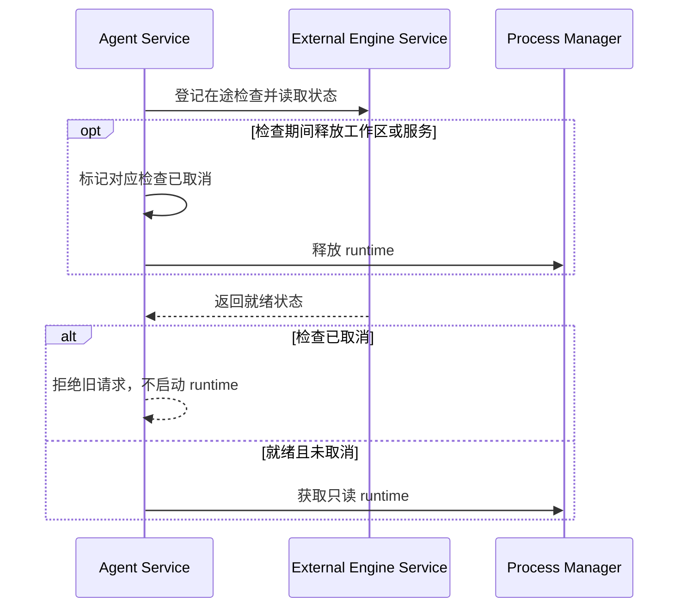

# External engine service

执行 Host 上的外部 Agent 引擎安装与就绪检测服务（`IExternalEngineService`）。

- `getStatus` / `listStatuses` 只读：检测 YCode 管理目录中的锁定版 adapter、PATH 中的官方 CLI（缺失时用 adapter 安装树内的官方 CLI），并调用官方 CLI 的登录状态命令。不读写 `~/.claude`、`~/.codex` 下的凭据文件。
- `installAdapter` 只能由用户在设置页显式触发，按 `EXTERNAL_ENGINE_RUNTIMES` 的锁定版本从 npm 官方 registry 安装。
- `ready` 是外部引擎会话的执行门禁；Agent Service 在未就绪时返回 `engine_not_ready`。
- PATH 中官方 CLI 若解析为 JavaScript 入口，版本与登录查询由当前运行时直接执行，避免桌面 PATH 缺少 node 时误判登录状态；原生 CLI 仍直接执行。

规则来源：`docs/desktop/external-agent-engines-spec.md`。

- 安装与状态命令由该服务统一持有；同一引擎安装 single flight，释放时取消并等待整棵子进程树，不发布迟到状态。
- 服务只在桌面本地注册。附件暂存、Stop、关闭不依赖内置 Provider 或登录状态；发送、创建、恢复仍执行外部引擎就绪门禁。
- Agent Service 持有在途就绪检查的取消标记；工作区或整个服务释放后，迟到结果不得启动 runtime 或预留项目 task。新请求使用独立标记，不继承旧请求的取消状态。

