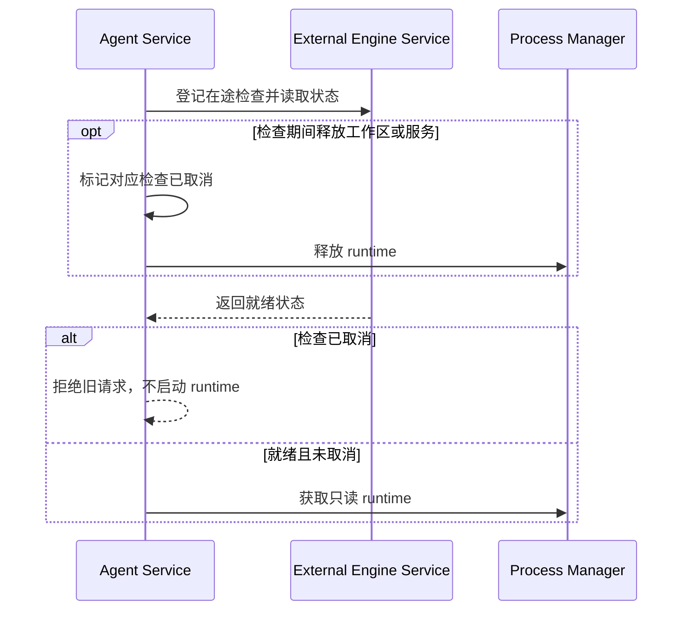

# External engine service

官方登录成功后由 Host 重读并广播安全完整 connections view，更新订阅者的有效默认配置（首次 Codex 登录可能从 inherit 恢复 official）；UI 只订阅该 owner，不额外维护默认事实。

2026-11-06：ready 表示本地可启动，不等同于账号已登录。getStatus 按引擎合并并发并缓存 60 秒；refreshStatus 显式失效。Host 独占连接配置的写入，凭据复用 CredentialService。Codex 的管理连接使用独立 ID/CODEX_HOME，旧配置保留，官方 login 可取消，不改用户 CLI 配置。

Codex 状态诊断使用当前连接的身份环境；API Key 模式只检查该 profile 的凭据是否存在，不执行原用户的 login status，也不验证供应商。官方 login 只做无子进程的可启动性预检。
检测失效按引擎切换代次：旧在途请求不阻挡新检测，迟到结果不回填缓存或发布状态广播。

2026-11-07：两家引擎对称支持沿用 CLI / 官方登录 / API Key 与多个命名配置。`updateConnectionProfiles` 是唯一写入命令（create / edit 新 ID / delete 隐藏 / select 上次使用），在文件锁内读改写 `connections.json`，成功后广播 `onConnectionProfilesChanged` 并使该引擎状态缓存失效；视图不含 credentialKey。诊断与登录环境使用共享 `buildEngineConnectionEnv`；状态附 `connectionProfileId`、`auth.gatewayHost` 与 `inheritedGatewayHost`（只读 config.toml / settings.json 的 base_url host）。Claude 官方登录运行 `claude auth login --claudeai`。`testConnection` 委托注入的 Agent Service 走 CLI `externalEngine/testConnection`，同一时间一个、可取消，日志只含引擎、配置 ID、分类与耗时。

执行 Host 上的外部 Agent 引擎安装与就绪检测服务（`IExternalEngineService`）。

- `getStatus` / `listStatuses` 只读：检测 YCode 管理目录中的锁定版 adapter、PATH 中的官方 CLI（缺失时用 adapter 安装树内的官方 CLI），并调用官方 CLI 的登录状态命令。不读写 `~/.claude`、`~/.codex` 下的凭据文件。
- `installAdapter` 只能由用户在设置页显式触发，按 `EXTERNAL_ENGINE_RUNTIMES` 的锁定版本从 npm 官方 registry 安装。
- `ready` 是外部引擎会话的执行门禁；Agent Service 在未就绪时返回 `engine_not_ready`。
- PATH 中官方 CLI 若解析为 JavaScript 入口，版本与登录查询由当前运行时直接执行，避免桌面 PATH 缺少 node 时误判登录状态；原生 CLI 仍直接执行。

规则来源：`docs/desktop/external-agent-engines-spec.md`。

- 安装与状态命令由该服务统一持有；同一引擎安装 single flight，释放时取消并等待整棵子进程树，不发布迟到状态。
- 服务只在桌面本地注册。附件暂存、Stop、关闭不依赖内置 Provider 或登录状态；发送、创建、恢复仍执行外部引擎就绪门禁。
- Agent Service 持有在途就绪检查的取消标记；工作区或整个服务释放后，迟到结果不得启动 runtime 或预留项目 task。新请求使用独立标记，不继承旧请求的取消状态。

2026-11-09 ACP 管理页：结构化检查为可选安全投影，认证/路由按 connectionProfileId 隔离，ready 仅为运行环境可用。配置先读、所选引擎独立诊断；查看不写上次使用，编辑 Dialog 沿用新 ID 保存与旧绑定。管理检查/安装支持按引擎取消，登录/测试沿用既有取消；详见 external-agent-engines-spec.md「设置诊断接口与取消边界」。
